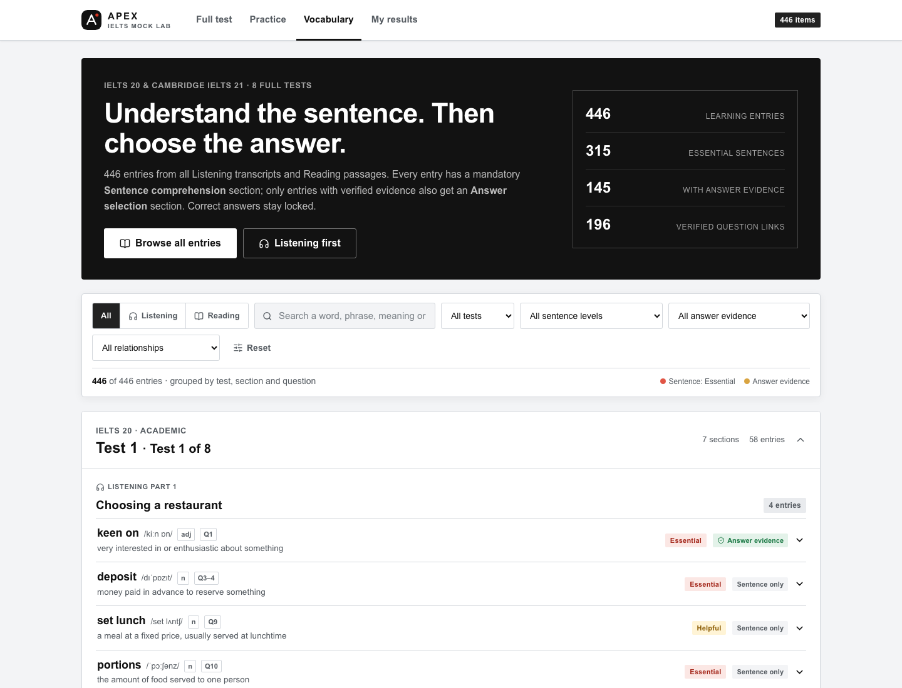
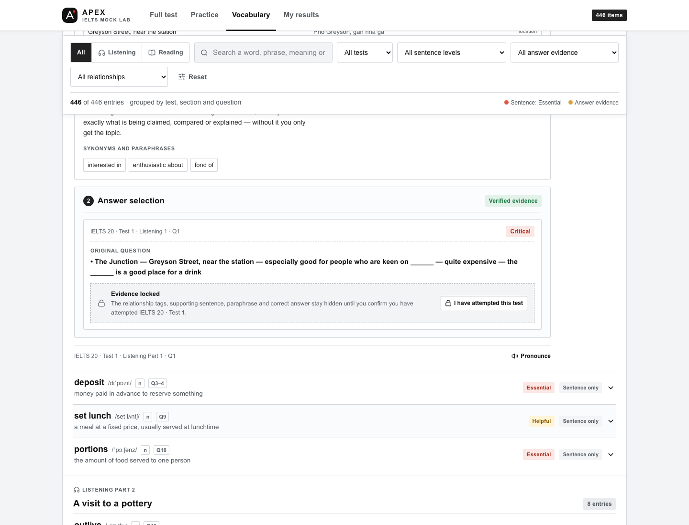

# Sentence & answer vocabulary — IELTS 20 & Cambridge IELTS 21





**446 unique entries** read from all 32 Listening parts and all 24 Reading passages in the
eight tests used by the lab. Every entry has a full **Sentence comprehension** study block.
**145 entries** also carry **verified Answer selection** evidence, covering **196 question
links**. Correct answers exist in the data but are hidden in the interface until the learner
confirms an attempt for that test.

> **Private study only.** The tests and example sentences are from IELTS 20 Academic and
> Cambridge IELTS 21 Academic, © Cambridge University Press & Assessment and Qunyan Press.
> Do not redistribute this pack or the extracted tests. Definitions, Vietnamese glosses,
> translations and importance labels are study aids.

## What is included

| File | Purpose |
|---|---|
| [`content/vocabulary/ielts20-21-learning-vocabulary.json`](../content/vocabulary/ielts20-21-learning-vocabulary.json) | Source of truth (dual-section entries) |
| [`apps/web/src/learning-vocabulary.json`](../apps/web/src/learning-vocabulary.json) | Runtime copy imported by the page |
| [`apps/web/app/vocabulary/page.tsx`](../apps/web/app/vocabulary/page.tsx) | Interactive list at `/vocabulary/` |
| [`content/vocabulary/work/`](../content/vocabulary/work/) | Skeleton, direct translations and verified answer evidence |
| [`content/vocabulary/ielts20-21-learning-vocabulary.xlsx`](../content/vocabulary/ielts20-21-learning-vocabulary.xlsx) | Formatted workbook: overview, entries, answer evidence, section summary |
| [`content/vocabulary/ielts20-21-learning-vocabulary.csv`](../content/vocabulary/ielts20-21-learning-vocabulary.csv) | Flat CSV for Excel, Sheets or Numbers |
| [`content/vocabulary/ielts20-21-learning-anki.csv`](../content/vocabulary/ielts20-21-learning-anki.csv) | Anki/Quizlet import (Front, Back, Tags) |
| [`content/vocabulary/tools/verify_learning_vocabulary.py`](../content/vocabulary/tools/verify_learning_vocabulary.py) | Validator |
| [`content/vocabulary/tools/build_learning_exports.py`](../content/vocabulary/tools/build_learning_exports.py) | Rebuilds XLSX/CSV/Anki exports (no answer keys) |

## Coverage

| Book | Test | Entries | With answer evidence |
|---|---|---:|---:|
| IELTS 20 | 1 | 58 | 15 |
| IELTS 20 | 2 | 57 | 17 |
| IELTS 20 | 3 | 69 | 19 |
| IELTS 20 | 4 | 56 | 20 |
| Cambridge 21 | 1 | 63 | 21 |
| Cambridge 21 | 2 | 46 | 17 |
| Cambridge 21 | 3 | 50 | 16 |
| Cambridge 21 | 4 | 47 | 20 |
| **Total** | **8 tests** | **446** | **145** |

- **56 sections**: 32 Listening parts and 24 Reading passages.
- **Skills by primary section**: 224 Listening · 222 Reading.
- **Entry sources**: 249 answer-focused exam entries + 197 sentence-comprehension entries.

### Importance mix

Sentence comprehension (all 446 entries):

| Level | Entries | Meaning |
|---|---:|---|
| Essential | 315 | The sentence's main point depends on this word |
| Helpful | 89 | Supports the point or carries a key paraphrase |
| Optional | 42 | Useful context, but the sentence survives without it |

Answer selection (196 links):

| Level | Links | Meaning |
|---|---:|---|
| Critical | 97 | The word or paraphrase controls the answer |
| Helpful | 62 | Helps confirm or reject an option |
| Not relevant | 37 | Evidence exists, but the word is not needed to answer |

## What each entry contains

### 1. Sentence comprehension (every entry)

- **Word or phrase**, IPA, part of speech.
- **English meaning** and **Vietnamese meaning** for the sense used in the test.
- **Original sentence** copied from the transcript, table/notes or passage.
- **Vietnamese translation** written directly for that sentence.
- **Sentence breakdown**: each chunk with its Vietnamese and its role (main idea, contrast,
  relative clause, result, condition, etc.).
- **Why you need this vocabulary**: what the word contributes to this sentence.
- **Misunderstanding risk**: the specific misreading to avoid.
- **Synonyms and paraphrases** for the sense used.
- **Sentence importance**: Essential / Helpful / Optional.

### 2. Answer selection (145 entries, 196 links)

Only included when a single sentence in the book really supports the recorded answer.

- **Test, skill, section, question number** and the **exact question**.
- **Exact supporting sentence**, copied verbatim from the section.
- **Vocabulary connection** and **paraphrasing** using only wording present in the question
  and the evidence.
- **Why it matters** and **potential mistake**.
- **Answer importance**: Critical / Helpful / Not relevant.
- **Correct answer**, stored but hidden until unlock.

### 3. Answer relationship tags (per verified question link)

Each verified answer link may carry one or more independent tags. Tags are derived only from the
exact question, the verbatim supporting sentence, the stored answer and the options — never
from general topic similarity.

| Tag | Meaning | Links |
|---|---|---:|
| **Correct Answer** | The vocabulary itself appears directly in the verified correct answer. | 17 |
| **Answer Evidence** | The vocabulary appears in the supporting sentence that establishes the answer. | 60 |
| **Paraphrase** | The vocabulary is the equivalent expression connecting question and evidence. | 132 |
| **Distractor** | The vocabulary is associated with a misleading or incorrect option. | 13 |

Tags overlap: one link can be both *Answer Evidence* and *Paraphrase*. A link may legitimately
carry no tag when none of the four relationships is verifiable, and no tag is ever assigned
merely because a word appears somewhere in the passage. *Correct Answer* and *Answer Evidence*
are always kept separate.

One entry can link to several questions. Repeated vocabulary is stored once; additional
sections appear under **Also appears in**.

## Interface

Open `/vocabulary/` in the running lab.

- Filters: **All / Listening / Reading**, **Test 1–8**, **sentence importance**, **answer
  importance**, **answer relationship** (Correct Answer / Answer Evidence / Paraphrase /
  Distractor), and free-text search across terms, meanings, translations, sentences,
  breakdowns, section titles and evidence.

- After unlock, each answer card shows its **Answer relationship** chips above the supporting
  sentence. Tags stay hidden before unlock because *Correct Answer* would identify the answer.
- Entries are grouped by **test → section → first question**, with test and entry counts.
- Each entry expands into two visually separate blocks: **1 Sentence comprehension** and
  **2 Answer selection**.
- A pill shows **Answer evidence** or **Sentence only**, so the learner knows whether answer
  material exists before opening the entry.
- Each answer card shows the exact question immediately, but the relationship tags, supporting
  sentence, paraphrase and correct answer stay behind an **Evidence locked** panel until the learner
  clicks **I have attempted this test**. The unlock is stored per book and test in
  `localStorage`.
- Pronunciation uses the browser's speech synthesis.
- Cross-references and duplicate collapsing are handled at data level.

## Selection method

1. Read every Listening part and Reading passage with its questions and options.
2. Keep vocabulary that controls comprehension or the question–evidence relationship.
3. For Sentence comprehension, select one representative sentence that uses the word in a
   test-relevant sense and record its full context.
4. Translate the sentence and break it into meaningful chunks directly — no translation API
   or web service is used.
5. For Answer selection, search the complete section text for the single sentence that
   supports the recorded answer. If the evidence is NOT GIVEN, split across sentences, or
   only inferable from a sentence fragment, the link is omitted rather than guessed.
6. Verify every support string is a whitespace-normalised substring of the book text.
7. Merge duplicate terms across tests and sections.

The target was approximately 600 entries, but the number was not forced. The remaining
candidate pool was dominated by basic words such as *restaurant*, *expensive*, *lunch* and
*chef*; adding them would have inflated the count without helping answer accuracy. The pack
stops at 446 defensible entries.

## Rebuilding and checking

```bash
python3 content/vocabulary/work/assemble_learning_pack.py
cp content/vocabulary/ielts20-21-learning-vocabulary.json apps/web/src/learning-vocabulary.json
python3 content/vocabulary/tools/verify_learning_vocabulary.py
```

The validator checks:

- 446 items, 56 sections, 8 tests;
- required fields (term, IPA, POS, English/Vietnamese meaning, synonyms, sentence,
  translation, breakdown, why, risk, importance);
- unique IDs and unique terms;
- every answer support string is verbatim in its stated section;
- every answer has a question, connection, paraphrase, why, mistake, importance and valid
  relevance tags;
- meta counts match the actual data.

## Known limits

- This is a focused learning pack, not a complete glossary. Many unfamiliar words in a test
  do not affect comprehension or answer choice and are deliberately excluded.
- 104 exam entries have no verified answer link. Most are NOT GIVEN questions, matching/heading
  questions whose evidence spans a paragraph, or items whose vocabulary role is comprehension
  rather than answer selection.
- IPA is a practical study transcription, not a specialist phonetics standard.
- Listening note/table entries show the whole row, so one row can contain more than one blank;
  this preserves the exact book context.
- Some answer links carry **Not relevant** importance because the evidence is real but the
  vocabulary is not needed to answer. They are labelled rather than hidden.
